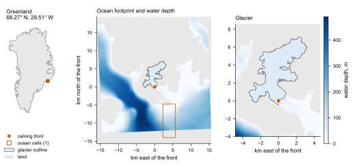
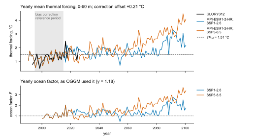
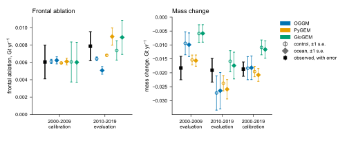
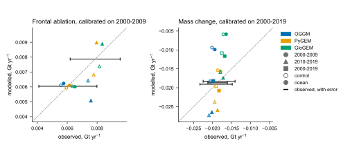
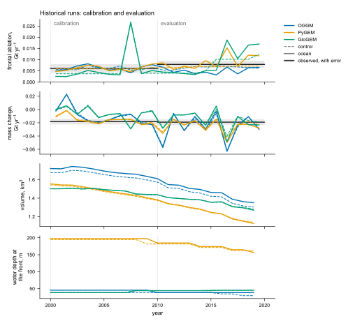
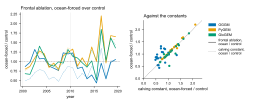
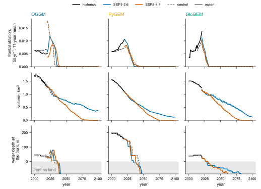

# Examples

```{include} ../examples/README.md
:start-after: "# Examples"
:end-before: "Every script reads"
```

```{admonition} Real data
:class: note

The figures below are made from the real data and the host runs of the example
glacier, in `examples/results/05-09345`. The synthetic case below runs the
same chain on a toy host and synthetic inputs.
```

```{include} ../examples/synthetic/README.md
:heading-offset: 1
```

## Figures of the example case

All of them are drawn by `docs/figures/results.py` from the files of a results
directory; no number in them is typed. Each host runs the historical period
twice on ERA5: a control run with the calving law of the host, and an
ocean-forced run with `tf_power` and GLORYS12. Each run has its own calving
constant, calibrated on the observed frontal ablation of 2000-2009; in the
ocean-forced run it is multiplied by the ocean factor `F`. Both runs then
continue to 2100 under SSP1-2.6 and SSP5-8.5.



**Map.** The location in Greenland; the water depth around the glacier
(BedMachine Greenland v6; land in grey) with the cell of the ocean reanalysis
nearest to the front; the glacier outline (RGI 7.0) and its terminus point.



**Forcing.** Yearly mean thermal forcing in the depth range of the law, from
GLORYS12 and from MPI-ESM1-2-HR after the bias correction; the grey band is
the period the correction is fitted on, and the dashed line is `TF_ref`. The
second panel shows the yearly ocean factor as one host used it.



**Calibration and evaluation.** Observed frontal ablation and geodetic mass
change with their errors (black), and the period means of each host, control
(open) and ocean-forced (filled), with the standard error of the mean: the
standard deviation of the yearly values over the square root of their number.
GloGEM's bar on 2000-2009 is wide because of its calving event in 2007. The
calving constant of each run is calibrated on 2000-2009 and the mass balance
on 2000-2019; the other periods are evaluations. The modelled mass change is
the change of volume between consecutive years of the historical run, at an
ice density of 900 kg m⁻³.



**Modelled against observed.** The same period means against the observed
value. The black bars are the observed values with their errors, on the
dashed one-to-one line; the observed mass change is nearly the same in the
three periods, so its bars overlap. The modelled values of a period are spread
sideways about the observed value, for legibility. The marker gives the
period; open markers are control, filled markers ocean-forced.



**Historical runs.** Yearly frontal ablation, mass change, volume and water
depth at the front, control (dashed) and ocean-forced (solid), per host; the
grey bands are the observed decade means with their errors. GloGEM removes a
band of its glacier that reaches sea level in one calving event, here in 2007;
the 2000-2009 mean includes it. In OGGM the front of the ocean-forced run
stands further out than that of the control run, until 2010 in deeper water,
which raises its flux there; its constant is therefore fitted lower than that
of the control run, and from 2010, back in shallower water, its flux falls
below the observed. PyGEM's front stands in deeper water than the other two,
because PyGEM sets the bed there by its own inversion (see the PyGEM example
below).



**What the ocean term does.** Yearly frontal ablation of the ocean-forced run
over that of the control run (solid), and the ratio of the calving constants
the two runs used (dotted): `k0 F` of the ocean-forced run over `k0` of the
control run. With the same geometry the two ratios are equal, as in PyGEM;
where the fronts of the two runs differ, in OGGM and in the years GloGEM
removes a band, they part.



**Projections.** The historical runs (black) and the runs under SSP1-2.6 and
SSP5-8.5 to 2100, control (dashed) and ocean-forced (solid), per host:
frontal ablation as a running mean, volume, and water depth at the front.
Below zero (grey) the front stands on land and frontal ablation stops. The
scenario runs take their climate from MPI-ESM1-2-HR, downscaled by each host,
and their ocean from MPI-ESM1-2-HR after the bias correction. GloGEM runs each
scenario as a run of its own from 2000, so its scenario runs start in 2020
from their own state, not from the end of its historical run.

## The host models

```{include} ../examples/oggm/README.md
:heading-offset: 2
```

```{include} ../examples/pygem/README.md
:heading-offset: 2
```

```{include} ../examples/glogem/README.md
:heading-offset: 2
```

## Datasets of the example case

The example uses the datasets below. Licences were checked on 10 October
2026 unless stated. Shipped with the package are the Greenland coastline of
the locator map and the per-glacier cut and the host results in
`examples/results/05-09345`; everything in `examples/results/synthetic` is
synthetic.

| Dataset | Used for | Licence | Shipped |
|---|---|---|---|
| GLORYS12, Global Ocean Physics Reanalysis (E.U. Copernicus Marine Service Information, 2018; Lellouche et al., 2021) | ocean, 1993 onwards; reference of the bias correction | Copernicus Marine Service licence: free use and redistribution, crediting "E.U. Copernicus Marine Service Information" (derived products: "Generated using E.U. Copernicus Marine Service Information") | thermal forcing at the front, 0-60 m, monthly |
| MPI-ESM1-2-HR, CMIP6 historical and ScenarioMIP SSP1-2.6 and SSP5-8.5 (Jungclaus et al., 2019; Schupfner et al., 2019; Müller et al., 2018) | ocean and climate, projection | CC BY 4.0 in the CMIP6 terms of use; the `license` attribute of the files, written in 2019, says CC BY-SA 4.0. Both allow redistribution with credit | thermal forcing at the front, 0-60 m, monthly, bias-corrected |
| ERA5 (Hersbach et al., 2020) | climate, historical | CC BY 4.0, crediting the Copernicus Climate Change Service | no |
| BedMachine Greenland v6 (Morlighem et al., 2025; Morlighem et al., 2017) | bed and water depth at the front | openly shared without restriction; the data citation is required | water depth within about 16 km of the front |
| RGI 7.0 and RGI 6.0 (RGI 7.0 Consortium, 2023; RGI Consortium, 2017) | glacier outline | CC BY 4.0 | the outline and terminus point of RGI 7.0 |
| Frontal ablation of Kochtitzky et al. (2022), Dataset S1; terminus positions (Kochtitzky and Copland, 2021) | calibration and evaluation targets | CC BY 4.0 (the article; Dataset S1 is its supplementary file) | the two target values, in `examples/case.json` and `forcing.json` |
| Glacier elevation change of Hugonnet et al. (2021), dataset at Theia | geodetic mass change, target of the mass balance | allows use of the data (checked 11 October 2026) | the glacier's mass change over three periods, in `examples/case.json` and `forcing.json` |
| IceBoost v2.0 ice thickness (Maffezzoli, 2025; Maffezzoli et al., 2025) | ice thickness and volume of the host runs | CC BY 4.0 (checked 11 October 2026) | no |
| Natural Earth, 1:50m land | coastline of the locator map | public domain | `docs/figures/data/greenland_ne50m.csv`, cut by `docs/figures/greenland_coast.py` |

The full references are in [references](references.md#datasets-of-the-examples).
The per-glacier cuts are shipped under the licences above, with the credit
they require; the elevation-change data of Hugonnet et al. (2021) are not shipped.
