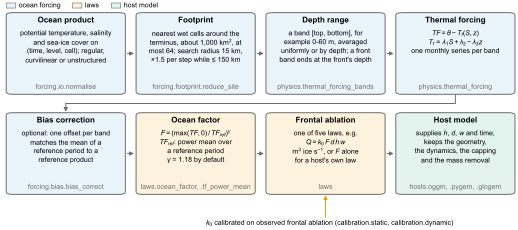
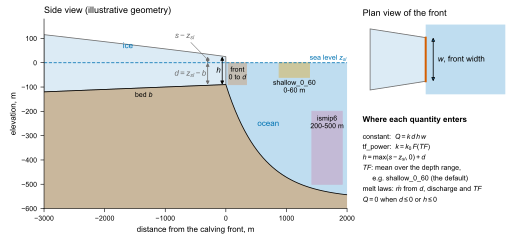
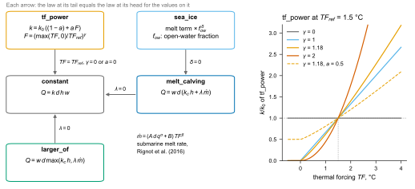
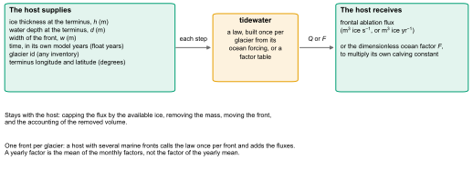
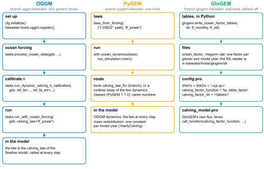
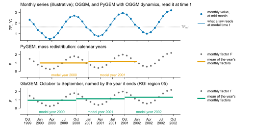

# How it works

Six diagrams of the method. Each is drawn by `docs/figures/schematics.py`
from the package itself: the depth ranges, the default exponent, the ocean
factor and the model years are computed by the functions they show.

## From an ocean product to a flux



An ocean product is read into one neutral layout, whatever its grid. Around
each terminus the nearest wet cells are found within a growing search radius
(`forcing.footprint.reduce_site`). Their temperature and salinity are
averaged over a depth range, and the thermal forcing is the temperature above
the local freezing point. An optional offset per depth range matches the mean
of a reference period to a reference product (`forcing.bias.bias_correct`).
The law turns the thermal forcing into a frontal ablation flux, or into the
ocean factor `F` for a host that keeps its own law. The calving constant is
calibrated on observed frontal ablation.

## The calving front



The host gives the ice thickness `h`, the water depth `d` and the width `w` at
the front. Thickness is freeboard plus water depth
(`physics.front_thickness`). The depth ranges are those of the default
parameter set: `shallow_0_60`, which the laws read by default, the ISMIP6
range of 200 to 500 m, and `front`, which ends at the front's own water depth.
A front on land (`d <= 0`) gives no flux.

## Five nested laws



Each law becomes a simpler one for a value of its parameters, so a host can
switch the ocean on in steps and compare each step with its present results.
On the right, `k / k0` of `tf_power` against the thermal forcing for several
exponents: every curve passes through 1 at `TF_ref`, and with `a = 0.5` half
of the constant stays when the water is at the freezing point.

## What a host gives and gets



The contract is the same for every host. The host keeps the glacier: its
geometry, the capping of the flux, the mass removal and the bookkeeping.

## Three coupling routes



OGGM calls the law at every time step of its flowline model, through
`tidewater.hosts.oggm` and four hooks on the `oggm-tidewater` branch. PyGEM
takes the law on its OGGM dynamics and a yearly constant on its
mass-redistribution model, through a hook on its branch or a swap of two
classes on released PyGEM 1.1.0. GloGEM reads one factor per glacier and
model year from a text table, through a hook that is off unless named in
`config.pro`.

## Time



The forcing is monthly. A law called at model time `t` reads the value
interpolated between mid-month points. A host that works in whole years gets
the mean of the monthly factors of each of its model years: calendar years for
PyGEM's mass-redistribution model, October to September for GloGEM in the
northern hemisphere. That mean is not the factor of the yearly mean thermal
forcing, because the factor is a power of the forcing clipped at zero. The
series in this figure is made up for the drawing.

## Making the figures

The SVG and PNG files are kept in `docs/img/`, so the documentation build runs
no code. To redraw them:

```bash
pip install -e ".[plot]"
python docs/figures/schematics.py
python docs/figures/results.py examples/results/05-09345
```

Every figure uses one font, one colour-blind-safe palette (Okabe-Ito) and an
opaque white page, so it reads the same on a light and a dark site; the scripts
stop if any text is smaller than 7 pt at print size.
